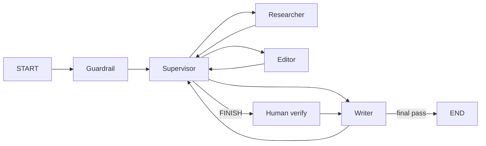

# Multi-Agent Newsroom (LangGraph)

A research-and-writing assistant built as a LangGraph multi-agent system. A supervisor routes a task between a researcher, a writer and an editor, a guardrail screens requests first, and a human-review step approves the final draft. It is served through FastAPI.

**Status:** working prototype. Setup below was written from the code and has not been re-run from a clean machine.

## Features

- **Supervisor pattern:** one node decides whether to research, write, edit or finish.
- **Corrective RAG researcher:** retrieves from a local Chroma knowledge base, grades the results, rewrites the query if they are irrelevant, and falls back to web search (Tavily).
- **Guardrail:** screens each request for prompt-extraction attempts, personal-data requests and off-topic input before any other agent runs.
- **Editor and revision loop:** the supervisor can send the draft back for edits.
- **Human verification step** before the draft is returned.
- **API:** FastAPI endpoints for a normal response (`POST /details`) and token streaming (`POST /details/stream`). Also runnable with LangGraph Studio through `langgraph.json`.

## Architecture



### Researcher (corrective RAG loop) (`agents/researcher.py`)

The researcher uses a **Corrective RAG** pattern , it grades its own retrieval and rewrites the query if the results are irrelevant.

```
START
  ↓
_agent  (LLM reads messages + RESEARCHER_SYS prompt, decides to call a tool)
  ↓ tools_condition
  ├── END  (no tool call → LLM has synthesized a final answer)
  └── ToolNode  (actually executes search_kb or web_search, appends ToolMessage to messages)
         ↓
     extract_docs  (reads last ToolMessage from messages, writes to state["docs"])
         ↓
       grade  (reads state["query"] + state["docs"], writes state["relevant"])
         ↓ route_grade
         ├── _agent  (relevant=True → LLM synthesizes final answer → tools_condition → END)
         └── rewrite  (relevant=False → rewrites query, appends new HumanMessage to messages)
                ↓
             _agent  (retry , LLM sees new message, calls search_kb again)
                ↓ (cycle repeats)
```

## Tech stack

Python 3.12, LangGraph, LangChain, OpenAI (`gpt-5-mini`), Chroma, Tavily, FastAPI, Docker.

## Setup

1. Create a `.env` file from `.env.example` and add your keys.
2. Build the knowledge base from the PDF in `kb/`, then run the API:

```bash
pip install -r requirements.txt
python kb/kb.py
uvicorn api.main:app --port 8000
```

3. Try it:

```bash
curl -X POST localhost:8000/details -H "Content-Type: application/json"   -d '{"task": "Summarise recent developments in solid-state batteries", "thread_id": "demo"}'
```

With Docker: `PORT=8000 docker compose up --build` (the container builds the knowledge base on start).

## Project structure

```
agents/    guardrail, supervisor, researcher, writer, editor, human_verify
tools/     search_kb (Chroma) and web_search (Tavily)
kb/        knowledge.pdf and kb.py, which builds the vector store
api/       FastAPI app
graph.py   outer graph definition
state.py   shared state types
```

## Limitations and roadmap

- Uses in-memory checkpointing, so sessions are lost on restart.
- No automated tests yet.
- Dependencies in `requirements.txt` are not version-pinned.

## License

MIT, see [LICENSE](LICENSE).

## Contact

Anubhav Gupta, [LinkedIn](https://www.linkedin.com/in/anubhav-gupta-92410a244/)

## Researcher node responsibilities

| Node | Reads from State | Writes to State |
|---|---|---|
| `_agent` | `messages` | `messages` (AIMessage with or without tool_calls) |
| `ToolNode` | `messages` (last AIMessage tool_calls) | `messages` (ToolMessage with tool output) |
| `extract_docs` | `messages` (last ToolMessage) | `docs` |
| `grade_agent` | `query`, `docs` | `relevant` |
| `rewrite_query_agent` | `query` | `query` (new value), `messages` (new HumanMessage) |


## State

### `MessagesState` , outer graph

```python
messages: Annotated[list[AnyMessage], operator.add]
next: str  # supervisor sets this to route to "researcher", "writer", or "FINISH"
```

### `ResearchState` , inner researcher graph

```python
messages: Annotated[list[AnyMessage], operator.add]
query: str    # the current search query; rewrite_query_agent updates this
docs: list    # raw retrieval results; extract_docs populates this
relevant: bool  # grade_agent sets this; used by route_grade to branch
```


## Design notes

**Why `extract_docs` is a separate node**
`ToolNode` is a LangGraph built-in , it only writes to `messages`. It has no awareness of custom state fields like `docs`. The `extract_docs` node bridges the gap: it reads from `messages` and writes to `docs` so `grade_agent` can operate on clean structured data.

**Why `rewrite_query_agent` must write to `messages`**
`_agent` only reads `state["messages"]` , it never reads `state["query"]`. If `rewrite_query_agent` only updated `state["query"]`, `_agent` would re-run with the same conversation history and repeat the same search. Writing a new `HumanMessage` into `messages` gives the LLM an explicit signal to search differently.

**Why `relevant=True` routes back to `_agent`**
When `grade_agent` approves the docs, `_agent` re-runs with the full conversation history (original query + tool call + tool result). The LLM synthesizes a final answer with no tool call, so `tools_condition` routes to `END`. The outer `researcher_agent` wrapper then picks up the last message and returns it to the supervisor.


## Tools

| Tool | Source | Purpose |
|---|---|---|
| `search_kb` | `tools/search_kb.py` | Searches local Chroma vector store (tries first) |
| `web_search` | `tools/web_search.py` | Falls back to web if KB yields nothing useful |
